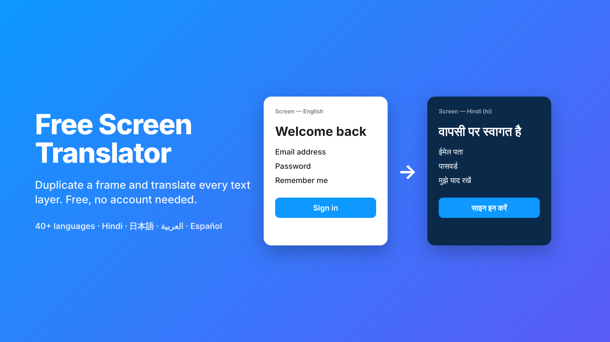

# Free Screen Translator (Figma plugin)



Select one or more frames, choose **From** / **To** languages, click **Translate copy**.
The plugin duplicates each frame to the right of the selection and translates every
text layer in the copy. The original is never modified. It's free: it uses the
MyMemory API (no signup) or your own LibreTranslate server.

## Install (development)

Download this repo (**Code → Download ZIP**) and unzip it, or clone it. If you want to change the code, install and build:

```bash
npm install
```

```bash
npm run build
```

In Figma desktop: **Plugins → Development → Import plugin from manifest…** and pick
`manifest.json`. (`code.js` is committed, so you can skip the build if you haven't changed `code.ts`.)

## Engines and limits

| Engine | Cost | Limit |
| --- | --- | --- |
| MyMemory | free, no key | 5,000 chars/day per IP; 50,000/day if you enter an email |
| LibreTranslate (self-hosted) | free | your server |

At 50k chars/day that's about 15–30 screens. Repeated strings are translated once,
and every translation is cached (`from|to|text` in `figma.clientStorage`), so reruns
and shared components cost nothing.

**LibreTranslate:** run it locally (`docker run -p 5000:5000 libretranslate/libretranslate`).
`http://localhost:5000` is already allowed for development. For any other server,
add its origin to `networkAccess.allowedDomains` in `manifest.json`.

## What it does

- **Remembers** From/To, engine, email and options between runs.
- **Copies** are placed at `x + selection width + 100` and named `Screen — Hindi (hi)`.
- **Instances:** text overrides are set directly; nothing is detached.
- **Skips** hidden layers (optional), plus text that has no letters (numbers, symbols, `{{placeholders}}`).
- **Protects** `{{x}}`, `{x}`, `%s`, URLs, emails and your *Don't translate* list from being translated.
- **Long text** over 500 bytes is split at sentence boundaries, with up to 4 requests in parallel.
- **Fonts:** every font a layer uses is loaded before its text changes. With *Swap font* on, scripts
  that Latin fonts don't cover get switched to a Noto family, keeping the weight and falling back to Regular:

  | Language | Font |
  | --- | --- |
  | Hindi, Marathi, Nepali | Noto Sans Devanagari |
  | Japanese | Noto Sans JP |
  | Korean | Noto Sans KR |
  | Chinese | Noto Sans SC / TC |
  | Arabic, Persian, Urdu | Noto Sans Arabic |
  | Hebrew | Noto Sans Hebrew |
  | Thai | Noto Sans Thai |
  | Bengali, Tamil, Telugu, Gujarati, Punjabi, Kannada, Malayalam | Noto Sans *script* |

- **Mixed-style text:** the first style is applied to the whole layer, and the layer is listed in the report.
- **Fixed-size boxes** whose new text overflows are listed in the report. Optionally they switch to auto-height.
- **RTL** (Arabic, Persian, Urdu, Hebrew): left-aligned text becomes right-aligned.
- **Failures:** whatever succeeded is kept, the copy is renamed `— partial`, and a rerun reuses the cache.

## Files

- `code.ts` → `code.js`: canvas side, with no network access. It clones frames, collects text, loads fonts and writes the results.
- `ui.html`: the panel. It holds the settings form, the fetch calls, placeholder protection, chunking and the report.
- `manifest.json`: the network allowlist.

Flow: the UI sends `start`; the code clones the frames and sends the unique uncached strings; the UI
translates them and returns `translated`; the code writes the text, updates the cache and quota, and sends `report`.

## Publishing

See [PUBLISHING.md](PUBLISHING.md) for the step-by-step guide, listing copy, icon and cover image.

The plugin ID (`1699370917156037806`) is already set in `manifest.json`. Publish from
**Plugins → Development → Publish**. Keep the network `reasoning` text: it is shown to users.

## License

MIT. See [LICENSE](LICENSE).
